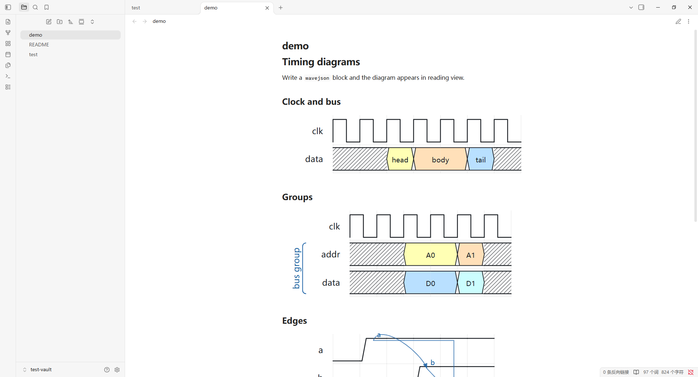
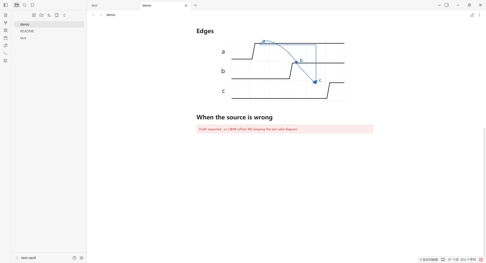

# WaveJSON

An Obsidian plugin that renders [WaveJSON](https://wavedrom.com/tutorial.html) timing diagrams inside your notes — and lets you edit them in place, without leaving the note.



## Features

- **Write, don't draw.** Put a `wavejson` code block in any note and the diagram appears in reading view.
- **Edit in place.** Click the pencil, change the waveform, click the checkmark. The code block is updated for you — no round trip to an external editor.
- **Renders like the original.** Same arrow shapes, group brackets, phase shifts and data labels as [WaveDrom](https://wavedrom.com/).
- **Fits your note.** The diagram scales to the width of the code block; `Ctrl`/`⌘` + scroll to zoom.
- **Stays out of the way.** Styles are scoped inside the plugin, so your theme and the plugin never fight.

## Installation

### BRAT (recommended while the plugin is not in the community list)

1. Install [BRAT](https://github.com/TfTHacker/obsidian42-brat) and enable it.
2. Run **BRAT: Add a beta plugin for testing**.
3. Enter `udarent/obsidian-plugins-wavejson` and confirm.

### Manual

1. Download `manifest.json`, `main.js` and `styles.css` from the [latest release](https://github.com/udarent/obsidian-plugins-wavejson/releases/latest).
2. Put all three in `<your-vault>/.obsidian/plugins/wavejson/`.
3. Reload Obsidian (`Ctrl`/`⌘` + `R`), then enable **WaveJSON** under *Settings → Community plugins*.

> This plugin is **not** in the community plugin list yet, so it will not show up in *Browse*.

## Usage

Add a fenced code block with the language `wavejson`:

````markdown
```wavejson
{ "signal": [
  { "name": "clk",  "wave": "p......" },
  { "name": "data", "wave": "x.34.5x", "data": ["head", "body", "tail"] }
] }
```
````

In reading view the block renders as a diagram (see the screenshot at the top of this page).

### Editing

- Hover the diagram and click the **pencil** in the top-right corner.
- Change the source, or click directly on waveform cells.
- Click the **checkmark** (or press `Esc`) to leave editing. The code block is rewritten with your changes.
- While editing, the toolbar offers undo, redo, split direction, and a source/diagram toggle.

The file is only written when you **leave** editing — the plugin never writes to your vault while you type.

### Supported syntax

Each object in the `signal` array is a row:

| Field | Meaning |
|---|---|
| `name` | Row label |
| `wave` | Waveform string — one character per time slot |
| `data` | Labels for bus rows, in order (`"x.34."` + `["head","body"]` → `3` = head, `4` = body) |
| `node` | Anchor letters used by `edge` (`.a....` puts anchor `a` in slot 1) |
| `phase` | Shift the row left (`0.5`) or right (`-0.5`) by a fraction of a slot |
| `period` | Stretch each character across `period` slots |

Common `wave` characters: `0`/`1` low/high, `x` undefined, `z` high-impedance, `p`/`P` positive clock, `n`/`N` negative clock, `d`/`u` falling/rising edge, `=`/`2`–`9` data, `.` hold previous value.

Groups, blank rows and edges:

```json
{ "signal": [
  { "name": "a", "wave": "01....", "node": ".a...." },
  { "name": "b", "wave": "0..1..", "node": "...b.." },
  {},
  ["bus", { "name": "d0", "wave": "x.3.x" }]
], "edge": ["a~>b", "b->a"] }
```

`edge` entries connect **node anchors**, not row names — a row without a `node` field cannot be an endpoint, and such an edge is skipped silently.

## When a diagram fails to parse

If the source has a syntax error, the diagram area is left empty and a red line appears under the block:



The message comes straight from the parser (`Draft: expected , or ] @48 …`). Nothing is lost — fix the JSON and the message disappears.

Two behaviours worth knowing:

- **Unknown characters in `wave` are ignored**, not reported. `0@1` renders as if the `@` were not there. That is the parser's tolerant mode, not a bug.
- **Only syntax errors are reported.** A structurally valid but visually wrong diagram will simply look wrong.

## Limitations

- The block is written back **only** when you leave editing. If you switch to another note mid-edit and return to the *same tab* (Obsidian keeps the view alive), your unsaved changes are still there and will be saved when you click the checkmark.
- The editing area has a fixed height of `min(72vh, 560px)`.
- Diagrams are not searchable — Obsidian only indexes the code block source.

## Development

The renderer and editor come from [TimingBench](https://github.com/udarent/TimingBench); this repository only contains the plugin shell. To build, clone both repositories side by side:

```text
<workspace>/
  TimingBench/                    # renderer + editor core
  obsidian-plugins-wavejson/      # this repo
```

```bash
npm install
npm run build     # bundles the core into main.js
npm run sync      # copies the build into a test vault (--dest=<vault path> to point elsewhere)
```

`main.js` is committed: it is what users install, and the release workflow ships it as-is without rebuilding.

## Credits

- Renderer and editor: [TimingBench](https://github.com/udarent/TimingBench)
- Diagram syntax: [WaveDrom](https://wavedrom.com/) by Aliaksei Chapyzhenka

## License

[MIT](LICENSE) © udarent
